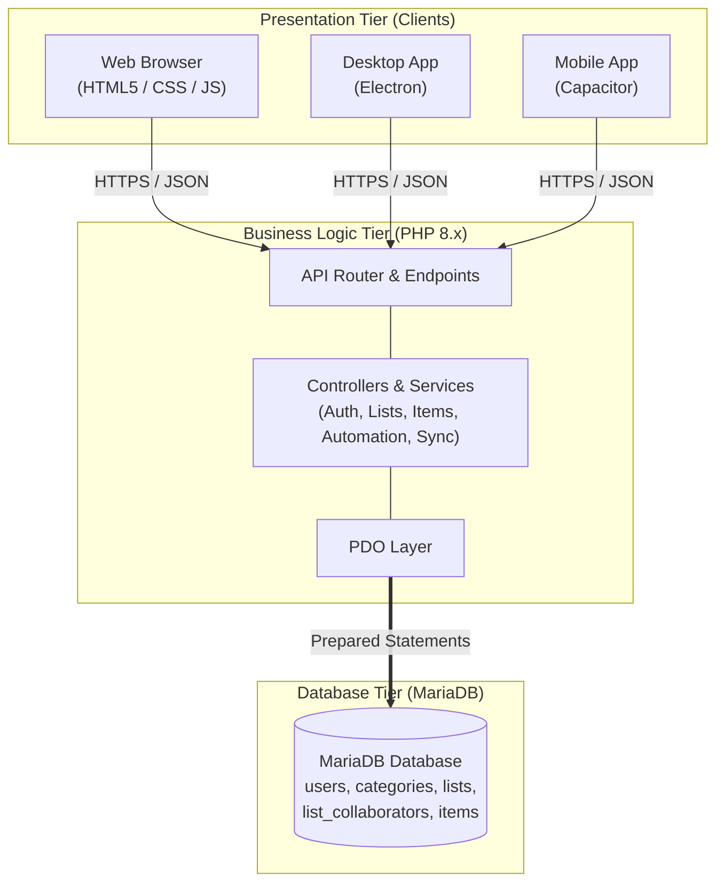
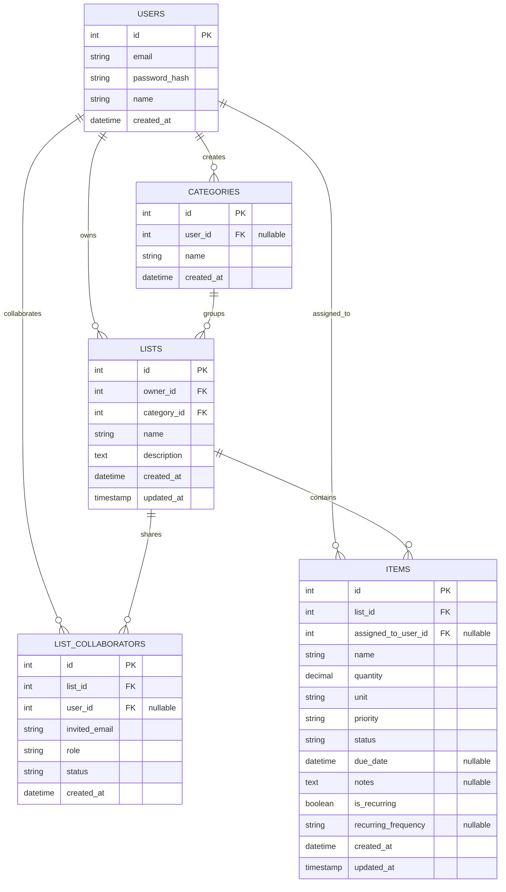
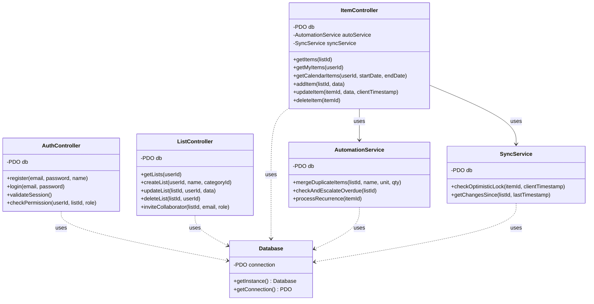
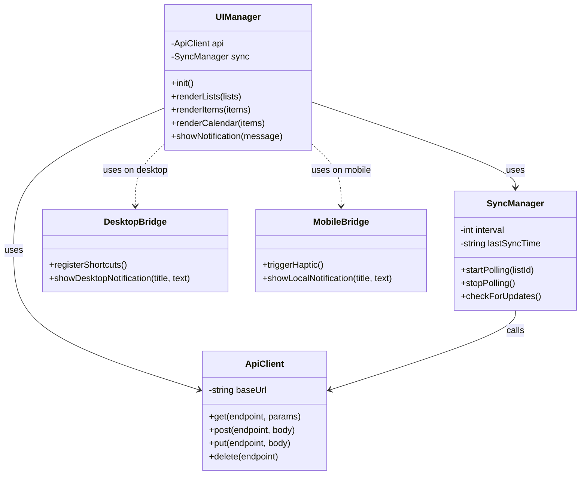
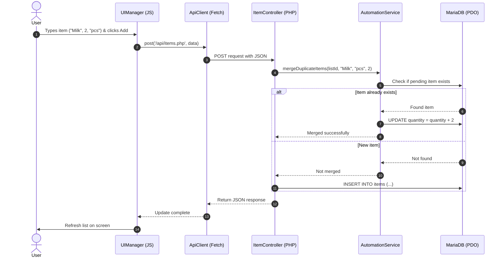

# Shared Lists – Task & List Management System

## 1. Project Overview

Shared Lists is a cross-platform application for creating, organizing, and sharing lists between multiple users (family members, students, teams). The system allows users to work on the same list in real time, organizes categories, and includes automated helpers like merging duplicate items and escalating overdue tasks.

---

## 2. Target Audience & Use Cases

- **Households:** Shared shopping and grocery lists, assigning household chores.
- **Students:** Group assignments, shared study plans, tracking deadlines.
- **Teams:** Simple task delegation, tracking work deliverables.
- **Events & Travel:** Vacation packing lists, party planning, and gift ideas.

---

## 3. Core Features

### 3.1. Lists & Categories

- **Lists:** Each list has a title, description, category, creation date, and an owner.
- **Categories:** Default categories (Shopping, Groceries, Household Chores, Travel, Study, Work, Events, Gift Ideas, Personal) plus support for custom categories created by users.
- **Filtering & Search:** Search lists by name, filter by category, and sort by date or name.

### 3.2. Items & Automation

- **Item Fields:** Name, description, quantity, unit (kg, pcs), priority (Low, Medium, High), status (Pending, Completed, Overdue), due date, notes, and assigned user.
- **Smart Deduplication:** If a user adds an item with the same name and unit as an existing pending item, the app automatically increases the quantity instead of making a duplicate.
- **Overdue Tasks:** When the due date passes and the task is still pending, the app marks it as Overdue and increases priority by one level (e.g., Low becomes Medium).
- **Recurring Items:** Tasks with a set frequency automatically reset back to Pending for the next cycle after being completed.

### 3.3. Collaboration & Real-Time Sync

- **Invitations & Roles:** Owners invite collaborators by email. Roles are Viewer (read-only) and Editor (can add, edit, and delete items).
- **Real-Time Polling:** The app automatically checks for updates in the background every few seconds so users see changes without manual page reloads.
- **Conflict Handling:** The system uses timestamps to check if another user modified an item before saving changes.

### 3.4. Extra Views

- **My Items:** A single screen showing all items assigned to the logged-in user across all lists, sorted by deadline.
- **Calendar:** Week and month view to see scheduled tasks and change due dates.

---

## 4. Technology Stack

| Platform / Tier     | Technology              | Reason for Selection                                                                 |
| :------------------ | :---------------------- | :----------------------------------------------------------------------------------- |
| **Web Frontend**    | HTML5, CSS3, JavaScript | Lightweight, native browser support, Fetch API for simple communication with backend |
| **Mobile**          | Capacitor               | Allows packaging the web code into an Android/iOS mobile application                 |
| **Desktop**         | Electron                | Wraps the application for desktop OS with system notifications                       |
| **Backend API**     | PHP 8.x                 | Efficient REST API processing JSON requests                                          |
| **Database**        | MariaDB                 | Reliable relational database with foreign key support                                |
| **Database Access** | PDO                     | Prepared statements to securely prevent SQL Injection                                |

---

## 5. System Architecture & Diagrams

### 5.1. Overall Architecture (Three-Tier Model)

Shows the communication flow between the frontend clients (Web, Electron, Capacitor), the PHP REST API, and MariaDB.

### 5.2 Database Schema (Entity-Relationship Diagram)

Shows the structure of the MariaDB database with all 5 tables, their fields, and the relationships between them.

---

### 5.3 Backend Class Diagram (PHP 8.x)

Shows the main backend classes in PHP, including controllers for API routing, services for automation/sync logic, and database access via PDO.

---

### 5.4 Frontend & Platform Class Diagram (JS / Electron / Capacitor)

Shows the client-side JavaScript structure, including the UI renderer, the API client, background polling, and native wrappers for Electron and Capacitor.

---

### 5.5 Sequence Diagram: Adding an Item with Deduplication

Shows the step-by-step process of adding a new item, including the database check to merge quantities if an identical pending item already exists.

